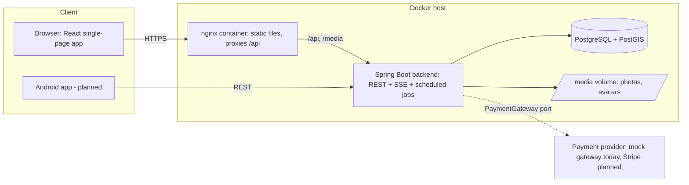

# Backend concepts

The main ideas behind the PARI backend: how it is built, how a request travels through it, and how the important business rules are implemented. It describes the code on `main` and says clearly what does not exist yet. For the stored data see [data-layer.md](data-layer.md), for every endpoint [api-reference.md](api-reference.md), for the conversation with the browser [frontend-backend-interaction.md](frontend-backend-interaction.md).

## 1. The system



| Part | Repository | Technology |
| --- | --- | --- |
| Backend service | `PARI_Eng_Project_backend_service` | Java 21, Spring Boot 4, Spring Security (JWT), Spring Data JPA / Hibernate, Flyway, PostgreSQL 16 + PostGIS, springdoc (OpenAPI), Gradle |
| Web frontend | `PARI_Eng_Project_front` | React 19, Vite, Tailwind CSS, served by nginx |
| Infrastructure | `PARI_Eng_Project_infra` | Docker Compose: `postgres`, `backend`, `front`; volumes `pari-pgdata` and `pari-media` |
| Android app | `PARI_Eng_Project_android` | planned, not part of this description |

Images are built by GitHub Actions and published to GitHub Container Registry (`ghcr.io/dizincorp/pari-backend`, `pari-front`); one `docker compose up -d` in the infra repository starts the whole system. The backend is one deployable unit (a modular monolith, [ADR 0001](adr/0001-modular-monolith-on-spring-boot.md)).

## 2. Structure of the code

The code is split by business area. Each module has the same layers and only depends downwards:

```
web         controllers and request/response records; no business rules, no entities returned
  |
service     use cases: one transaction each, rules that span several objects, DTOs for the web layer
  |
repository  Spring Data interfaces and the few native queries
  |
domain      JPA entities with their own rules, value objects, enums
```

| Module | Responsibility | Requirement ids cited in the code |
| --- | --- | --- |
| `auth` | registration, login, JWT, security filter chain, change password, profile | NF03, NF06 |
| `user` | user entity, roles, vehicles, payment methods | NF03, NF04 |
| `spot` | spaces, photos, amenities, map search, live occupancy (SSE) | F01-F04, F09-F12 |
| `availability` | weekly schedule, blocked periods, "can this range be booked" | F03 |
| `reservation` | pricing, booking, accept/reject, check-in/out, overstay, analytics, expiry and overdue jobs | F05, F08, F13-F16, F18, F19, NF08 |
| `payment` | gateway port and mock, charges, refunds, penalties, payouts (soft escrow), withdrawals | F06, F17-F19, F22, NF03 |
| `review` | ratings of spaces | F20, F21 |
| `premium` | owner Premium plan | F08 |
| `notification` | in-app notifications from reservation events | F07, F16, F25 |
| `media` | image upload and serving | none |
| `verification`, `support` | inspection requests, reports and sanctions: entities only | F10, F21-F25 |
| `common` | `Money`, `TimeRange`, `BaseEntity`, encryption, audit trail, platform settings, error handling, scheduling switch | NF04, NF05 |

Services of one module use services and, in places, repositories of another (for example `ReservationService` reads spaces, users and vehicles directly); cross-cutting reactions use **domain events** (section 5). The module boundary is a convention, not yet enforced by an architecture test.

## 3. How a request travels

1. **nginx or Vite proxy** forwards `/api/**` to the backend (the browser talks to one origin, so no CORS configuration is needed).
2. **Security filter chain** (`SecurityConfig`): CSRF, sessions, basic and form login are off (the API is stateless). The bearer token is validated by the Spring OAuth2 resource server (HS256 key from `PARI_JWT_SECRET`) and turned into an `AuthUser(id, roles)`. Public endpoints are listed explicitly; everything else under `/api` needs a token. Failures answer with the common error body.
3. **Controller** binds and validates the request (`@Valid`, Bean Validation), takes the caller's id with `@CurrentUserId` (never from the body) and calls one service method.
4. **Service** runs in one database transaction (`@Transactional`), loads entities, checks the rules, changes state through entity methods, saves, records the audit entry and publishes events.
5. **Entity methods** guard their own state machine; an illegal move throws `IllegalStateTransitionException`.
6. **`ApiExceptionHandler`** maps exceptions to the uniform error body (`400`, `401`, `402`, `403`, `404`, `409`, `413`), see the [API notes](api-reference.md#errors). Unexpected database rejections become `409 CONSTRAINT_VIOLATION`.
7. The response is a DTO. Lazy associations are never serialised, so the API does not depend on the entity graph.

## 4. Security

- **Passwords**: BCrypt. Login does a hash comparison even for unknown e-mails, so response time does not reveal which accounts exist; the error is the same (`INVALID_CREDENTIALS`).
- **Token**: JWT with `sub` and `roles`, 24 h, no refresh and no revocation (*planned*). Roles are re-read from the token, so a role change needs a new login.
- **Authorisation** is done in services, close to the data: ownership ("the owner of this space"), role ("OWNER required"), state ("only a COMPLETED reservation"). Unknown and foreign objects both answer `404` where existence should not leak.
- **Personal data** is encrypted or hashed at rest ([data-layer.md section 6](data-layer.md#6-sensitive-data)). Secrets come from environment variables; the keys in `application-local.yml` and in tests are marked development-only.
- **Uploads**: the type is detected from the file's own bytes, the stored name is a random UUID, the key can never leave the storage directory, 5 MB limit.
- **Development shortcut**: `X-User-Id` authentication exists only behind `pari.security.jwt.dev-header-auth=true`.
- **Not done**: rate limiting and lockout on login, registration reveals whether an e-mail or phone number is taken (`409`), e-mail and phone verification, HTTPS termination (left to the proxy).

## 5. Transactions and concurrency

- One use case is one transaction. **Booking** is a single transaction that saves the reservation (taking the slot), charges the card, confirms the reservation, creates the payout, writes the audit entry and the notifications. If the gateway throws, everything rolls back; if the gateway declines, the reservation is saved as `CANCELLED` with the reason and the driver gets `402`.
- **Two drivers booking the same slot**: the service checks for overlaps, but the final arbiter is the database exclusion constraint. The loser's insert fails and becomes `409 SPOT_ALREADY_RESERVED`. No application lock is needed.
- **Lost updates**: every entity has a `version` column (optimistic locking).
- **Jobs and users racing** (for example the driver checks out while the scheduler ends the session): each job re-reads the row in its own transaction and does nothing when the state has already changed.
- **Events** are published with Spring's `ApplicationEventPublisher`. The notification listener runs inside the publishing transaction, so notifications are never left behind by a rolled-back booking. The live-occupancy event is delivered to SSE clients only **after commit**.

## 6. Business rules

### Pricing (`PricingService`)

The server is the only source of prices. For a booking it computes, from the space's hourly price and `platform_settings`:

1. base cost = hourly price x duration, prorated by the minute (half-up rounding to a grosz);
2. long-term discount for `MONTHLY` bookings (3 to 5 months, 6 to 11, 12 and more; percentages are placeholders);
3. service fee = share of the spot cost, added to what the driver pays;
4. commission = share of the spot cost, taken from the owner; **zero** while the owner has an active Premium plan;
5. total = spot cost + service fee.

The same calculation answers the public `POST /api/reservations/quote` and the real booking, and the result is frozen on the reservation. An **overstay** beyond the reserved end plus a grace period is charged as hourly price x penalty multiplier x started minutes, counted from the reserved end.

### Booking and the session (`ReservationService`)

Booking checks, in order: account not blocked, `DRIVER` role, space exists and is bookable, not the caller's own space, the vehicle is the caller's, the start is in the future, the owner offers the time (availability), the slot is free. Then it prices, saves, charges and either confirms (auto-accept: PIN and QR token are issued) or waits for the owner (`PENDING_APPROVAL`). Reject, expire and cancel refund the whole charge and cancel the payout (a placeholder rule: no cancellation fee until the team decides one). **Check-in** needs the PIN or QR token and the reserved period; it marks the space `OCCUPIED`. **Check-out** (or the scheduler) completes the reservation, charges an overstay penalty if due and frees the space. See the diagrams in [data-layer.md](data-layer.md#3-lifecycles).

### Payments (`payment` module)

`PaymentGateway` is a **port**: `charge`, `refund`, `payout`, each idempotent per key. Today's only adapter is `MockPaymentGateway` (tokens `pm_card_visa` and similar succeed, `pm_card_chargeDeclined` and `pm_card_chargeDeclinedInsufficientFunds` fail), selected by `pari.payment.provider=mock` ([ADR 0004](adr/0004-payment-gateway-port-with-mock.md)). A Stripe adapter would replace it without touching the services.

**Soft escrow**: money for the owner is not paid at once. A `SCHEDULED` payout is released (`PAID`) 24 h after the reservation ends (`payout_delay_hours`); only released money counts as the owner's available balance and can be withdrawn. A withdrawal (`POST /api/owner/payouts/withdraw`) goes through the gateway, stores the IBAN encrypted and returns it masked.

### Availability and search

A space has a weekly schedule and one-off blocked or open periods (`AvailabilityService`). **Map search** is one native PostGIS query (`ParkingSpotRepository.searchNearby`): active spaces within a radius (`ST_DWithin` on the generated geography column, GiST index), optional price and verified filters, and no overlapping slot-holding reservation in the requested range; Premium owners sort first, then by distance. The weekly schedule is applied afterwards to the returned candidates, in Java, because it depends on local days.

### Premium, reviews, notifications, analytics

- **Premium** (`PremiumService`): a plan is bought through the gateway (placeholder prices), gives 0 % commission and search priority; cancelling keeps it until the end of the paid period.
- **Reviews**: only the driver of a `COMPLETED` reservation, once; the space's cached average is recalculated.
- **Notifications**: `NotificationEventListener` turns each `ReservationEvent` (booked, requested, accepted, rejected, cancelled, expired, checked in, overstay, auto check-out) into one or two in-app notifications (Polish texts, JSON payload with the reservation, code and space ids). E-mail and push are *planned*.
- **Analytics**: owner revenue (7 days, 30 days or the current month, from completed reservations, in the business time zone) and driver totals are computed on the server.

## 7. Background jobs

All jobs call a service method that does the work in its own transactions, so tests call the services directly (`pari.scheduling.enabled=false` in tests).

| Job | Default interval | What it does |
| --- | --- | --- |
| `ReservationExpiryJob` | 1 min (`pari.reservation.expiry-check-interval`) | expires `PENDING_APPROVAL` requests older than `approval_timeout_minutes` or already started, and refunds them |
| `OverdueSessionJob` | 1 min (`pari.reservation.overdue-check-interval`) | completes `IN_PROGRESS` sessions that are past the end plus the grace period, charges the overstay, frees the space, notifies both sides |
| `PayoutReleaseJob` | 10 min (`pari.payout.release-interval`) | releases `SCHEDULED` payouts whose `release_at` has passed |

*Not scheduled yet*: cancelling unpaid `PENDING_PAYMENT` reservations after `payment_timeout_minutes` (the repository query exists, the mock gateway answers synchronously so the case does not occur today).

## 8. Configuration

| Setting (environment variable) | Meaning |
| --- | --- |
| `PARI_DB_URL`, `PARI_DB_USER`, `PARI_DB_PASSWORD` | PostgreSQL connection |
| `PARI_DATA_KEY` | base64 of 32 bytes, AES-256 key for personal data (required; the application refuses to start without it) |
| `PARI_JWT_SECRET` | base64 of at least 32 bytes, HS256 signing key (required) |
| `PARI_MEDIA_DIR`, `PARI_PUBLIC_BASE_URL` | where uploaded images are stored, and the public origin used in their URLs |
| `SPRING_FLYWAY_LOCATIONS` | `classpath:db/migration` (clean) or with `,classpath:db/dev` (demo data) |
| `SPRING_PROFILES_ACTIVE` | `local` adds development keys and the `X-User-Id` shortcut; `seed` adds the demo data |
| `pari.time-zone` | business time zone (`Europe/Warsaw`) |
| `pari.payment.provider` | `mock` (only value today) |
| `pari.scheduling.enabled` | switch for the jobs (off in tests) |

Business values (commission, fees, timeouts, discounts) are **not** configuration but rows in `platform_settings`, changeable at runtime.

## 9. Quality: tests and delivery

- **Tests** (about 330, all run by `./gradlew test`): plain unit tests of domain rules and value objects; `@DataJpaTest` repository and service tests against a real PostgreSQL + PostGIS in Testcontainers with the real Flyway migrations (constraints, queries, pricing, booking, payouts); `@WebMvcTest` controller tests with the real security configuration (status codes, error bodies, roles); `DemoDataTest` and `EmptyDatabaseTest` for the two database variants. Docker must be running.
- **CI** (`.github/workflows/ci.yml`): `./gradlew build` on every pull request and push to `main`. **Publish** (`publish-image.yml`): after every merge to `main` the backend image is pushed to GHCR.
- **Workflow**: every change reaches `main` through a pull request; schema changes come with a new migration and tests; rules for contributors and agents are in [AGENTS.md](../AGENTS.md).
- **API documentation**: Swagger UI at `/swagger-ui.html`, OpenAPI at `/v3/api-docs`; [api-reference.md](api-reference.md) is generated from it.

## 10. Not implemented yet

Refresh tokens and server-side logout, e-mail and phone verification, password reset, rate limiting, support reports and sanctions, inspection workflow for verified spaces, extending a reservation, PDF confirmation, real Stripe payments, e-mail and push notifications, the penalty in the owner's payout, a defined "total saved" for drivers, strict Polish phone-number validation, the Android client.
