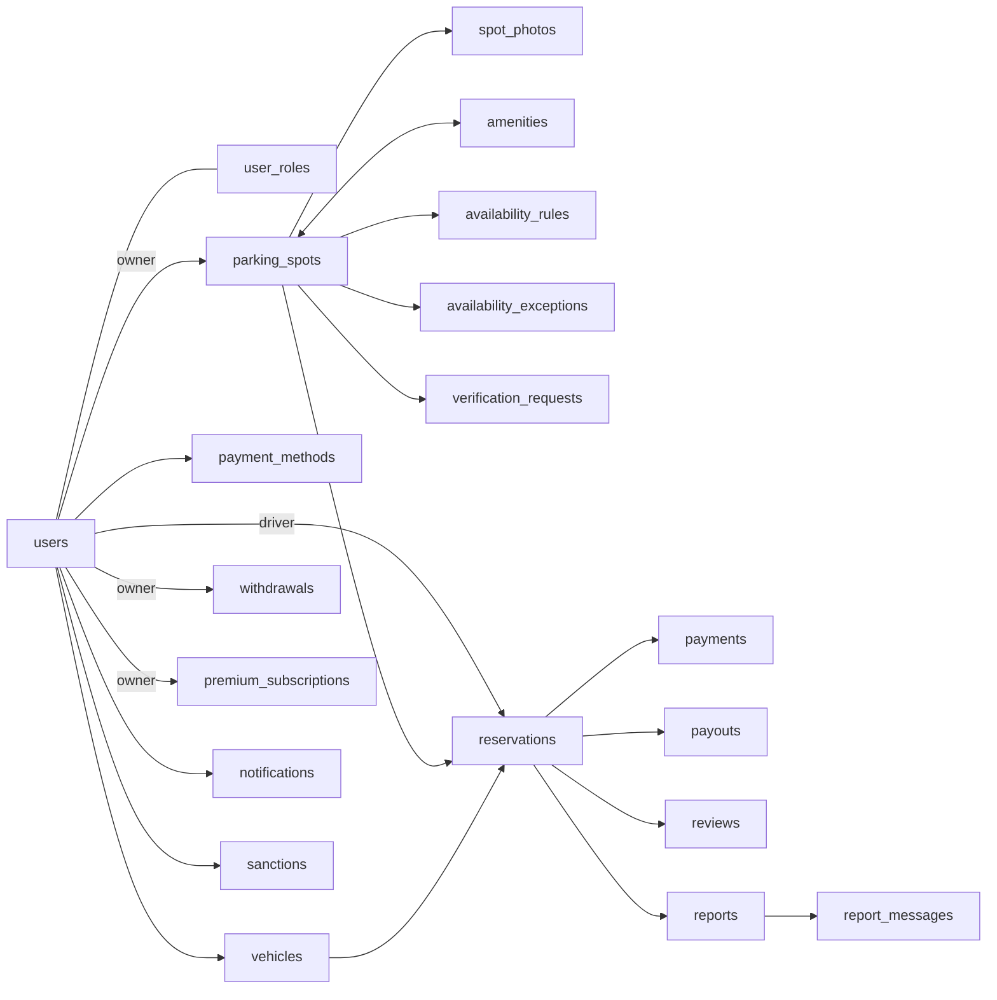
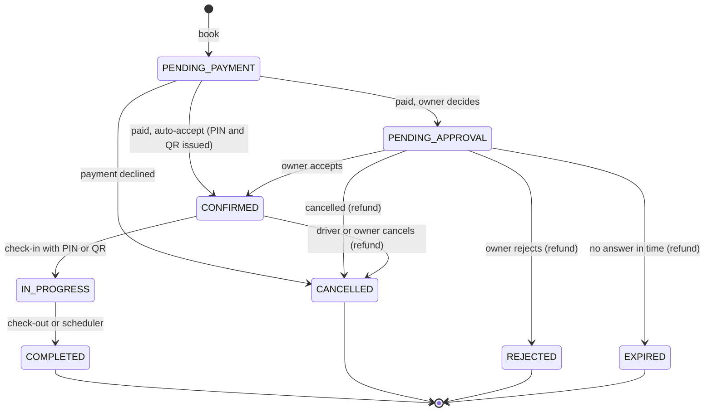
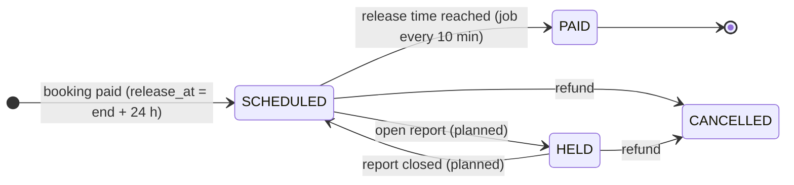
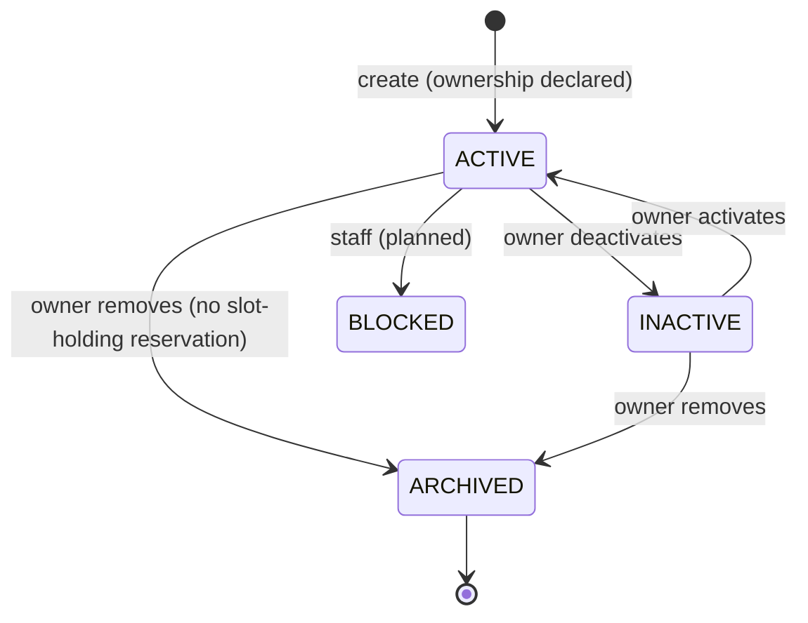

# Data layer

How PARI stores its data: the rules every table follows, how tables map to code, the lifecycles of the main objects, the guarantees the database itself enforces, and how a database is created in each environment. It describes the code on `main`. Column-by-column detail is in the generated [data dictionary](data-dictionary.md), the picture in the [ERD](diagrams/erd-backend.md).

## 1. Principles

| Principle | What it means in practice |
| --- | --- |
| **Flyway owns the schema** | Every change is a migration in `src/main/resources/db/migration` (`V1` to `V6` today). Hibernate only checks that the entities match (`ddl-auto=validate`). A merged migration is never edited; a fix is a new migration. |
| **PostgreSQL 16 + PostGIS** | One relational database. PostGIS gives the geography type and `ST_DWithin` for the map search; `btree_gist` gives the exclusion constraint that forbids double booking. |
| **Rules live in the database too** | Types, `NOT NULL`, `CHECK`, unique and exclusion constraints reject wrong data even when the application has a bug (section 5). |
| **Keys** | `uuid` primary keys, generated by the application (`GenerationType.UUID`), so ids can be created before the insert and never leak a counter. |
| **Common columns** | Every entity extends `BaseEntity`: `id`, `created_at`, `updated_at` (set by Hibernate) and `version` (optimistic lock: a stale update fails instead of overwriting). `audit_log` and `platform_settings` are the exceptions. |
| **Time** | `timestamptz`, always UTC in the database and `Instant` in Java. Local time (`Europe/Warsaw`) is applied only where the business needs a local day: weekly availability and the owner statistics. |
| **Money** | `bigint` minor units (grosze), currency PLN, in Java the `Money` value object (`MoneyConverter`). No `double` anywhere near money. Rounding is half up, in one place (`Money.multiply`). |
| **Enums** | Stored as `varchar` with a `CHECK` listing the values. Adding a value needs a Java change and a migration. |
| **No hard deletes of business data** | A removed space becomes `ARCHIVED`, a cancelled booking keeps its row, so payments, payouts and reviews never lose their reference. Rows are deleted only where nothing depends on them (vehicles, photos, calendar blocks). |
| **Personal data** | Phone number and IBAN are encrypted (AES-256-GCM), the password is a BCrypt hash, the phone has an HMAC fingerprint for uniqueness (section 6). |
| **Business values are data** | Commission, fees, timeouts and discounts are rows in `platform_settings`, read through `PlatformSettings`, not constants. Values the team has not decided are marked `PLACEHOLDER` in the migration. |

## 2. From table to code

Code is organised by module, `src/main/java/pl/pollub/pari/<module>/{domain,repository,service,web}`. A table belongs to the module that owns its concept.

| Module | Tables | Entities (`domain`) | Used by |
| --- | --- | --- | --- |
| `user` | `users`, `user_roles`, `vehicles`, `payment_methods` | `User`, `Vehicle`, `PaymentMethod`, enum `Role` | registration, profile, vehicles, penalty charge |
| `auth` | `auth_tokens` | `AuthToken` | nothing yet (refresh and verification tokens are planned) |
| `spot` | `parking_spots`, `spot_photos`, `amenities`, `spot_amenities` | `ParkingSpot`, `SpotPhoto`, `Amenity`, value objects `Address`, `GeoPoint`, `Dimensions`, enums `SpotStatus`, `Occupancy` | create, edit, search, photos, live occupancy |
| `availability` | `availability_rules`, `availability_exceptions` | `AvailabilityRule`, `AvailabilityException` | weekly schedule, blocked periods, booking check |
| `reservation` | `reservations` | `Reservation`, enums `ReservationStatus`, `BookingType` | booking, session, analytics |
| `payment` | `payments`, `payouts`, `withdrawals` | `Payment`, `Payout`, `Withdrawal`, enums `PaymentType`, `PaymentStatus`, `PayoutStatus`, `WithdrawalStatus` | charge, refund, penalty, escrow, withdrawal |
| `review` | `reviews` | `Review` | rating a space |
| `premium` | `premium_subscriptions` | `PremiumSubscription`, `PremiumPlan` | commission waiver, search priority |
| `notification` | `notifications` | `Notification` | in-app notifications |
| `verification` | `verification_requests` | `VerificationRequest` | queued when an owner asks for an inspection; no workflow yet |
| `support` | `reports`, `report_messages`, `sanctions` | `Report`, `ReportMessage`, `Sanction` | nothing yet (planned) |
| `common` | `audit_log`, `platform_settings` | `AuditLogEntry`, `PlatformSetting`, value objects `Money`, `TimeRange` | audit trail, business settings |

Associations are `LAZY`. Controllers never return entities, only DTOs (`*View`, `*Response`), so the schema can change without changing the API.

### Relationships at a glance

## 3. Lifecycles

### Reservation

`reservations.status` changes only through methods on `Reservation`; an illegal change throws `IllegalStateTransitionException`, which the API answers with `409 INVALID_STATE`.

A reservation **holds its time slot** in `PENDING_PAYMENT`, `PENDING_APPROVAL`, `CONFIRMED` and `IN_PROGRESS` (`ReservationStatus.SLOT_HOLDING`). The same list is the `WHERE` clause of the constraint `reservations_no_overlap` and of the search query; the three must stay equal (a rule in `AGENTS.md`). `PENDING_PAYMENT` exists inside one transaction today (the mock gateway answers at once), but the status and the timeout setting are ready for an asynchronous provider.

### Money of one reservation

Prices are calculated by `PricingService` from the spot price and `platform_settings` and **frozen on the reservation** (`hourly_rate_minor`, `spot_cost_minor`, `service_fee_minor`, `total_minor`, `commission_minor`), so a later price change never alters an existing booking. Example with the placeholder rates (service fee 5 %, commission 10 %), 3 hours at 12.00 PLN:

| Item | Amount | Where stored |
| --- | --- | --- |
| Spot cost (3 x 12.00) | 36.00 | `reservations.spot_cost_minor` |
| Service fee, added for the driver (5 % of the spot cost) | 1.80 | `service_fee_minor` |
| **Driver pays** | **37.80** | `total_minor`, `payments` (CHARGE) |
| Commission, taken from the owner (10 % of the spot cost; 0 for Premium owners) | 3.60 | `commission_minor`, `payouts.commission_minor` |
| **Owner receives** | **32.40** | `payouts.net_minor` (`CHECK net = gross - commission`) |
| Platform keeps | 5.40 | fee + commission |

For a `MONTHLY` booking of 3 or more months a discount percent is subtracted from the spot cost first (the owner carries it). An overstay past the reserved end plus the grace period is charged to the driver as a separate `PENALTY` payment and recorded in `overstay_penalty_minor` and `final_cost_minor`; it is **not** yet added to the owner's payout.

### Payment and payout

`payments` records every call to the payment provider: `CHARGE` at booking, `PENALTY` at check-out, `REFUND` on reject, expire or cancel; each `PENDING`, `SUCCEEDED` or `FAILED`. A failed charge stays as a `FAILED` row so support can see it. `provider_ref` is unique, so a repeated provider message cannot create a second row.

The owner balance is derived, not stored: **available** = `PAID` payouts minus `COMPLETED` withdrawals, **pending** = `SCHEDULED` + `HELD` payouts, **total earned** = all `PAID` payouts, **fees paid** = their commission. A withdrawal checks the available balance inside its transaction.

### Parking space

`DRAFT` exists in the schema and in the demo data but the API creates spaces directly as `ACTIVE` (the check `parking_spots_active_requires_declaration` forbids `ACTIVE` without `ownership_declared_at`, F09). `occupancy` (`FREE` or `OCCUPIED`) is separate from `status`: it flips on check-in and check-out and is pushed to map clients over SSE. `is_verified` is a flag meant to be set by an inspection; there is no inspection workflow yet, and a verification request is only queued. `avg_rating` and `review_count` are a cache, recalculated from visible reviews each time a review is added.

### Availability

A space with **no** weekly rules is open around the clock. Otherwise every local calendar day of a booking must be covered by a weekly rule (ISO day of week, local start and end time, optional `valid_from` and `valid_to`) or by an `OPEN` exception. A `BLOCKED` exception always wins. Existing reservations are checked separately, by the exclusion constraint and by the service.

## 4. Reference data

The migrations also insert the data the application cannot run without; every database variant has it:

- `amenities`: `COVERED`, `EV_CHARGER`, `GATE`, `CCTV`, `LIGHTING`, `DISABLED_ACCESS`, `WIDE_SPACE`.
- `platform_settings`: 13 rows (commission, service fee, penalty multiplier and grace period, payout delay, approval and payment timeouts, warning limit, Premium prices, long-term discounts). The current values and which ones are placeholders are listed in the [data dictionary](data-dictionary.md#platform-settings-reference-data-from-the-migrations).

## 5. What the database guarantees on its own

| Guarantee | Mechanism |
| --- | --- |
| No double booking of a space, even for two simultaneous requests | exclusion constraint `reservations_no_overlap` on `(spot_id, tstzrange(starts_at, ends_at))` for slot-holding statuses; the loser gets `409 SPOT_ALREADY_RESERVED` |
| Reservation ends after it starts; money is not negative | `CHECK` constraints |
| A space is active only with a declared right to it (F09) | `parking_spots_active_requires_declaration` |
| Owner payout adds up | `payouts`: `net_minor = gross_minor - commission_minor`; one payout per reservation (`reservation_id` unique) |
| One review per reservation and author; rating 1 to 5 | unique `(reservation_id, author_id)`, `CHECK` |
| One account per e-mail (case-insensitive) and per phone number | unique index on `lower(email)`; unique `phone_hash` |
| A rejected inspection has a reason | `verification_requests` `CHECK` |
| The audit trail cannot be changed | triggers reject `UPDATE`, `DELETE` and `TRUNCATE` on `audit_log` |
| Idempotent provider events | unique `payments.provider_ref` |
| Lost updates | `version` column on every entity (optimistic locking) |

The audit trail records `BOOKED`, `ACCEPTED`, `REJECTED`, `CANCELLED`, `EXPIRED`, `PAYMENT_FAILED`, `CHECKED_IN`, `WITHDRAWN`, `SUBSCRIBED` and `RELEASED` with the actor, the entity and a JSON detail.

## 6. Sensitive data

| Data | Stored as | Code |
| --- | --- | --- |
| Password | BCrypt hash in `users.password_hash`; login compares against a dummy hash for unknown e-mails so timing does not reveal accounts | `AuthService`, `JwtConfig` |
| Phone number | `users.phone_enc`: base64(IV + ciphertext + tag), AES-256-GCM with a random IV per value; key `PARI_DATA_KEY` | `EncryptedStringConverter` |
| Phone uniqueness | `users.phone_hash`: HMAC-SHA256 of the normalised number, keyed with the same key, so equality can be tested without decrypting | `PhoneHasher` |
| IBAN of a withdrawal | `withdrawals.iban`, encrypted like the phone number; API answers show it masked (`****2874`) | `Withdrawal.maskedIban()` |
| Card | only the provider token, brand, last four digits and expiry (`payment_methods`) | `PaymentMethod` |
| Uploaded images | files on the media volume, referenced by `storage_key`; names are random UUIDs | `MediaStorage` |

Losing `PARI_DATA_KEY` makes phone numbers and IBANs unreadable, and a changed key invalidates `phone_hash`. Keep it with the database backups.

## 7. Creating a database

| Variant | Contents | How |
| --- | --- | --- |
| **Clean** (default) | schema + reference data, no users | profile `local`, or `SPRING_FLYWAY_LOCATIONS=classpath:db/migration` (the Docker default) |
| **Seeded** (optional) | the same + a consistent demo data set | profile `local,seed`, or `SPRING_FLYWAY_LOCATIONS=classpath:db/migration,classpath:db/dev` |
| **Tests** | clean schema in a throw-away PostgreSQL + PostGIS container (Testcontainers), shared by the tests of a Spring context, every test rolled back | `DbTestBase` |

The seeded data lives in `db/dev/R__demo_data.sql`, a **repeatable** migration: Flyway runs it after every versioned one, so a new `V7` never conflicts with it; it runs once and does nothing when the demo users exist. It contains 4 users, 5 spaces and 11 reservations in every state with their charges, refunds, payouts, reviews and notifications, computed with the same pricing rules as the application. `DemoDataTest` checks that the data is consistent. A database keeps the variant it was created with. Commands are in the [README](../README.md#run-against-a-local-database).

## 8. Known gaps

- `auth_tokens`, `reports`, `report_messages`, `sanctions` and the inspection part of `verification_requests` have tables and entities but no endpoint.
- The overstay penalty is not part of the owner's payout.
- `users.loyalty_points` exists but nothing awards points.
- Spot `BLOCKED` and payout `HELD` have no trigger yet (they belong to support and reports).
