# Class diagram: application structure

Controllers, services, ports and adapters, scheduled jobs and domain events of the PARI backend. Spring Data repositories are omitted. Responsibilities and design rules are in Confluence: *PARI backend class diagram*.

```mermaid
classDiagram
    direction LR

    class AuthController
    class UserController
    class SpotController
    class AvailabilityController
    class ReservationController
    class OwnerController
    class PaymentWebhookController
    class ReviewController
    class ReportController
    class VerifierController
    class SupportController
    class AdminController
    class SpotStreamController

    class AuthService {
        +register(RegisterRequest) AuthResponse
        +login(LoginRequest) AuthResponse
        +refresh(String) AuthResponse
        +verifyEmail(String) void
        +resetPassword(String, String) void
    }
    class UserService {
        +getProfile(UUID) UserDto
        +switchRole(UUID, Role) Role
        +exportData(UUID) DataExport
    }
    class SpotService {
        +create(UUID, CreateSpotRequest) SpotDto
        +update(UUID, UUID, UpdateSpotRequest) SpotDto
        +setRealtimeStatus(UUID, UUID, boolean) SpotDto
        +addPhotos(UUID, UUID, List~MultipartFile~) void
    }
    class SpotSearchService {
        +search(SpotSearchCriteria, Pageable) Page~SpotCardDto~
    }
    class AvailabilityService {
        +calendar(UUID, YearMonth) List~CalendarDayDto~
        +isAvailable(UUID, TimeRange) boolean
        +blockSlot(UUID, UUID, TimeRange) void
        +replaceRules(UUID, UUID, List~RuleDto~) void
    }
    class PricingService {
        +quote(UUID, TimeRange) PriceQuote
        +overstayPenalty(Reservation, Instant) Money
        +refundFor(Reservation, Instant) Money
    }
    class ReservationService {
        +calculate(CalculateRequest) PriceQuote
        +create(UUID, CreateReservationRequest) ReservationDto
        +cancel(UUID, UUID, String) ReservationDto
        +checkIn(UUID, UUID, CheckInRequest) ReservationDto
        +checkOut(UUID, UUID) ReservationDto
        +activeSession(UUID) ActiveSessionDto
        +accept(UUID, UUID) void
        +reject(UUID, UUID, String) void
        +pdf(UUID, UUID) byte[]
    }
    class PaymentService {
        +startPayment(Reservation, String) PaymentIntentDto
        +onPaymentSucceeded(String) void
        +onPaymentFailed(String) void
        +refund(Reservation, Money) Payment
        +chargePenalty(Reservation, Money) Payment
    }
    class PayoutService {
        +schedule(Reservation) Payout
        +releaseDue(Instant) int
        +earnings(UUID, YearMonth) EarningsDto
    }
    class ReviewService {
        +submit(UUID, UUID, ReviewRequest) ReviewDto
        +moderate(UUID, ReviewStatus) void
        +recalculateRating(UUID) void
    }
    class ReportService {
        +open(UUID, OpenReportRequest) ReportDto
        +reply(UUID, UUID, String) void
        +resolve(UUID, UUID, String) void
    }
    class SanctionService {
        +warn(UUID, UUID, String) Sanction
        +block(UUID, UUID, String) Sanction
        +unblock(UUID, UUID) Sanction
    }
    class VerificationService {
        +request(UUID, UUID) VerificationRequest
        +claim(UUID, UUID) void
        +approve(UUID, UUID, String) void
        +reject(UUID, UUID, String) void
    }
    class PremiumService {
        +subscribe(UUID) PremiumDto
        +cancel(UUID) void
        +isPremium(UUID) boolean
    }
    class NotificationService {
        +notify(UUID, NotificationType, Map) void
        +list(UUID, Pageable) Page~NotificationDto~
    }
    class AuditService {
        +record(UUID, String, UUID, String, Map) void
    }
    class SpotStatusPublisher {
        +publish(UUID, Occupancy) void
        +subscribe(Set~UUID~) SseEmitter
    }

    class PaymentGateway {
        <<interface>>
        +createIntent(Money, String, String) GatewayIntent
        +refund(String, Money) GatewayRefund
        +transferToOwner(String, Money) GatewayTransfer
    }
    class StripePaymentGateway
    class FileStorage {
        <<interface>>
        +put(String, InputStream, String) void
        +presignedUrl(String) URL
        +delete(String) void
    }
    class S3FileStorage
    class GeocodingClient {
        <<interface>>
        +geocode(Address) GeoPoint
    }
    class GoogleGeocodingClient
    class PdfGenerator {
        <<interface>>
        +confirmation(Reservation) byte[]
    }
    class OpenPdfGenerator
    class MailSender {
        <<interface>>
        +send(String, String, String) void
    }
    class SmsSender {
        <<interface>>
        +send(String, String) void
    }

    class PayoutReleaseJob
    class ReservationExpiryJob
    class ReservationReminderJob
    class OverstayJob
    class SpotScheduleJob
    class PremiumExpiryJob

    class DomainEvent {
        <<interface>>
    }
    class ReservationConfirmed
    class CheckedIn
    class CheckedOut
    class ReservationCancelled
    class VerificationDecided
    class ReportClosed

    AuthController --> AuthService
    UserController --> UserService
    SpotController --> SpotService
    SpotController --> SpotSearchService
    SpotController --> AvailabilityService
    AvailabilityController --> AvailabilityService
    ReservationController --> ReservationService
    OwnerController --> ReservationService
    OwnerController --> PayoutService
    OwnerController --> PremiumService
    OwnerController --> VerificationService
    PaymentWebhookController --> PaymentService
    ReviewController --> ReviewService
    ReportController --> ReportService
    VerifierController --> VerificationService
    SupportController --> ReportService
    SupportController --> SanctionService
    SupportController --> ReviewService
    AdminController --> AuditService
    SpotStreamController --> SpotStatusPublisher

    ReservationService --> AvailabilityService
    ReservationService --> PricingService
    ReservationService --> PaymentService
    ReservationService --> PayoutService
    ReservationService --> PdfGenerator
    ReservationService --> SpotStatusPublisher
    ReservationService ..> AuditService
    ReservationService ..> DomainEvent : publishes
    PaymentService --> PaymentGateway
    PaymentService ..> AuditService
    PayoutService --> PaymentGateway
    PayoutService ..> AuditService
    SpotService --> FileStorage
    SpotService --> GeocodingClient
    SpotSearchService --> PremiumService
    AuthService --> SmsSender
    SanctionService --> ReservationService
    SanctionService --> PaymentService
    ReportService --> PayoutService
    VerificationService ..> DomainEvent : publishes
    ReportService ..> DomainEvent : publishes

    StripePaymentGateway ..|> PaymentGateway
    S3FileStorage ..|> FileStorage
    GoogleGeocodingClient ..|> GeocodingClient
    OpenPdfGenerator ..|> PdfGenerator

    ReservationConfirmed ..|> DomainEvent
    CheckedIn ..|> DomainEvent
    CheckedOut ..|> DomainEvent
    ReservationCancelled ..|> DomainEvent
    VerificationDecided ..|> DomainEvent
    ReportClosed ..|> DomainEvent
    NotificationService ..> DomainEvent : listens
    NotificationService --> MailSender
    NotificationService --> SmsSender

    PayoutReleaseJob --> PayoutService
    ReservationExpiryJob --> ReservationService
    ReservationReminderJob --> NotificationService
    OverstayJob --> ReservationService
    SpotScheduleJob --> SpotStatusPublisher
    PremiumExpiryJob --> PremiumService
```

