# Class diagram: domain model

Entities and value objects of the PARI backend (Java, Spring Boot, JPA). Enumerations, the class-to-table mapping and the reservation lifecycle are in Confluence: *PARI backend class diagram*.

```mermaid
classDiagram
    direction LR

    class BaseEntity {
        <<abstract>>
        +UUID id
        +Instant createdAt
        +Instant updatedAt
        +long version
    }
    note for BaseEntity "Every entity below extends BaseEntity. version is used for optimistic locking."

    class Money {
        <<value object>>
        +long amountMinor
        +String currency
        +add(Money) Money
        +subtract(Money) Money
        +multiply(BigDecimal) Money
    }
    class TimeRange {
        <<value object>>
        +Instant start
        +Instant end
        +overlaps(TimeRange) boolean
        +contains(Instant) boolean
        +duration() Duration
    }
    class Address {
        <<embeddable>>
        +String street
        +String city
        +String postalCode
        +String country
    }
    class GeoPoint {
        <<embeddable>>
        +double lat
        +double lng
    }
    class Dimensions {
        <<embeddable>>
        +int lengthCm
        +int widthCm
        +int heightCm
        +fits(Dimensions) boolean
    }

    class User {
        +String email
        +String passwordHash
        +String firstName
        +String lastName
        +String phone
        +boolean emailVerified
        +boolean phoneVerified
        +UserStatus status
        +Role activeRole
        +int loyaltyPoints
        +Set~Role~ roles
        +hasRole(Role) boolean
        +switchRole(Role) void
        +block() void
        +unblock() void
    }
    class Vehicle {
        +String model
        +String plateNumber
    }
    class PaymentMethod {
        +String providerRef
        +String brand
        +String last4
        +int expMonth
        +int expYear
        +boolean isDefault
    }
    class AuthToken {
        +AuthTokenType type
        +String tokenHash
        +Instant expiresAt
        +Instant usedAt
        +isUsable(Instant) boolean
    }

    class ParkingSpot {
        +String name
        +String description
        +Address address
        +GeoPoint location
        +Dimensions dimensions
        +Money hourlyPrice
        +String accessInstructions
        +boolean autoAccept
        +boolean realtimeStatusEnabled
        +Occupancy occupancy
        +SpotStatus status
        +boolean verified
        +Instant ownershipDeclaredAt
        +BigDecimal avgRating
        +int reviewCount
        +activate() void
        +deactivate() void
        +markVerified() void
        +isBookable(TimeRange) boolean
        +occupy() void
        +release() void
    }
    class SpotPhoto {
        +String storageKey
        +int position
    }
    class Amenity {
        +String code
        +String label
    }
    class AvailabilityRule {
        +int dayOfWeek
        +LocalTime startTime
        +LocalTime endTime
        +LocalDate validFrom
        +LocalDate validTo
        +covers(TimeRange) boolean
    }
    class AvailabilityException {
        +TimeRange period
        +ExceptionKind kind
        +String reason
    }

    class Reservation {
        +String code
        +TimeRange period
        +ReservationStatus status
        +Money hourlyRate
        +Money spotCost
        +Money serviceFee
        +Money total
        +Money commission
        +String pinCode
        +String qrToken
        +Instant checkInAt
        +Instant checkOutAt
        +Money overstayPenalty
        +Money finalCost
        +String cancelReason
        +Instant cancelledAt
        +markPaid(boolean autoAccept) void
        +accept() void
        +reject(String) void
        +checkIn(Instant) void
        +checkOut(Instant) void
        +cancel(User, String) void
        +holdsSlot() boolean
    }
    class ReservationStatus {
        <<enumeration>>
        PENDING_PAYMENT
        PENDING_APPROVAL
        CONFIRMED
        IN_PROGRESS
        COMPLETED
        CANCELLED
        REJECTED
    }
    class Payment {
        +PaymentType type
        +String providerRef
        +Money amount
        +PaymentStatus status
    }
    class Payout {
        +Money gross
        +Money commission
        +Money net
        +PayoutStatus status
        +Instant releaseAt
        +Instant paidAt
        +String providerRef
        +hold() void
        +release() void
    }
    class Review {
        +int rating
        +String comment
        +ReviewStatus status
        +hide() void
        +restore() void
    }

    class Report {
        +String category
        +String description
        +ReportStatus status
        +String resolution
        +Instant closedAt
        +assignTo(User) void
        +resolve(String) void
        +close() void
    }
    class ReportMessage {
        +String body
        +boolean internalNote
    }
    class Sanction {
        +SanctionType type
        +String reason
    }
    class VerificationRequest {
        +VerificationStatus status
        +String rejectionReason
        +String notes
        +Instant requestedAt
        +Instant decidedAt
        +claim(User) void
        +approve(String) void
        +reject(String) void
    }

    class Notification {
        +String type
        +String title
        +String body
        +Map payload
        +NotificationChannel channel
        +Instant readAt
        +markRead() void
    }
    class PremiumSubscription {
        +String plan
        +SubscriptionStatus status
        +Instant startedAt
        +Instant expiresAt
        +isActive(Instant) boolean
    }
    class AuditLogEntry {
        +long id
        +String entityType
        +UUID entityId
        +String action
        +Map data
        +Instant createdAt
    }
    class PlatformSetting {
        +String key
        +String value
    }

    User "1" --> "0..*" Vehicle : registers
    User "1" --> "0..*" PaymentMethod : saves
    User "1" --> "0..*" AuthToken : owns
    User "1" --> "0..*" ParkingSpot : owns
    User "1" --> "0..*" Notification : receives
    User "1" --> "0..*" PremiumSubscription : buys
    User "1" --> "0..*" Sanction : receives

    ParkingSpot *-- Address
    ParkingSpot *-- GeoPoint
    ParkingSpot *-- Dimensions
    ParkingSpot ..> Money : hourlyPrice
    ParkingSpot "1" *-- "0..*" SpotPhoto
    ParkingSpot "0..*" o-- "0..*" Amenity
    ParkingSpot "1" *-- "0..*" AvailabilityRule
    ParkingSpot "1" *-- "0..*" AvailabilityException
    ParkingSpot "1" --> "0..*" VerificationRequest : submitted for
    AvailabilityException *-- TimeRange

    Reservation "0..*" --> "1" ParkingSpot : books
    Reservation "0..*" --> "1" User : driver
    Reservation "0..*" --> "1" Vehicle : uses
    Reservation *-- TimeRange
    Reservation ..> Money
    Reservation --> ReservationStatus
    Reservation "1" --> "0..*" Payment : paid by
    Reservation "1" --> "0..1" Payout : settled by
    Payout "0..*" --> "1" User : owner
    Payment ..> Money
    Payout ..> Money

    Reservation "1" --> "0..*" Review : rated in
    Review "0..*" --> "1" User : author
    Review "0..*" --> "1" User : reviewee
    Review "0..*" --> "0..1" ParkingSpot : about spot

    Reservation "1" --> "0..*" Report : subject of
    Report "0..*" --> "1" User : reporter
    Report "0..*" --> "0..1" User : reportedUser
    Report "0..*" --> "0..1" User : assignedTo
    Report "1" *-- "0..*" ReportMessage
    ReportMessage "0..*" --> "1" User : author
    Sanction "0..*" --> "0..1" Report : caused by
    Sanction "0..*" --> "1" User : issuedBy
    VerificationRequest "0..*" --> "1" User : requestedBy
    VerificationRequest "0..*" --> "0..1" User : verifier
    AuditLogEntry ..> User : actor
```

