# Backend ERD (PostgreSQL)

Database model of the PARI backend. Entity descriptions, integrity rules and the reservation status lifecycle are in Confluence: *PARI data model (ERD): backend and frontend*.

```mermaid
erDiagram
    USERS {
        uuid id PK
        string email UK
        string password_hash
        string first_name
        string last_name
        string phone_enc "AES-256 (NF04)"
        boolean email_verified
        boolean phone_verified
        string status "ACTIVE|BLOCKED"
        string active_role "DRIVER|OWNER"
        int loyalty_points "frontend-driven, not in plan"
        timestamptz created_at
    }
    USER_ROLES {
        uuid user_id PK, FK
        string role PK "DRIVER|OWNER|VERIFIER|SUPPORT|ADMIN"
    }
    AUTH_TOKENS {
        uuid id PK
        uuid user_id FK
        string type "REFRESH|EMAIL_VERIFY|PHONE_CODE|PASSWORD_RESET"
        string token_hash
        timestamptz expires_at
        timestamptz used_at
    }
    VEHICLES {
        uuid id PK
        uuid user_id FK
        string model
        string plate_number
    }
    PAYMENT_METHODS {
        uuid id PK
        uuid user_id FK
        string provider_ref "Stripe pm_..."
        string brand
        string last4
        int exp_month
        int exp_year
        boolean is_default
    }
    PARKING_SPOTS {
        uuid id PK
        uuid owner_id FK
        string name
        string description
        string street
        string city
        string postal_code
        string country
        geography location "PostGIS Point, GiST index"
        int length_cm
        int width_cm
        int height_cm
        int hourly_price_minor
        string currency
        string access_instructions
        boolean auto_accept
        boolean realtime_status_enabled "F04"
        string occupancy "FREE|OCCUPIED"
        string status "DRAFT|ACTIVE|INACTIVE|BLOCKED"
        boolean is_verified "badge F24"
        timestamptz ownership_declared_at "F09"
        numeric avg_rating "denormalised"
        int review_count "denormalised"
        timestamptz created_at
    }
    SPOT_PHOTOS {
        uuid id PK
        uuid spot_id FK
        string storage_key
        int position
    }
    AMENITIES {
        uuid id PK
        string code UK
        string label
    }
    SPOT_AMENITIES {
        uuid spot_id PK, FK
        uuid amenity_id PK, FK
    }
    AVAILABILITY_RULES {
        uuid id PK
        uuid spot_id FK
        int day_of_week "1-7"
        time start_time
        time end_time
        date valid_from
        date valid_to
    }
    AVAILABILITY_EXCEPTIONS {
        uuid id PK
        uuid spot_id FK
        timestamptz starts_at
        timestamptz ends_at
        string kind "BLOCKED|OPEN"
        string reason
    }
    RESERVATIONS {
        uuid id PK
        string code UK "RSV-..."
        uuid spot_id FK
        uuid driver_id FK
        uuid vehicle_id FK
        timestamptz starts_at
        timestamptz ends_at
        string status "PENDING_PAYMENT|PENDING_APPROVAL|CONFIRMED|IN_PROGRESS|COMPLETED|CANCELLED|REJECTED"
        int hourly_rate_minor "snapshot"
        int spot_cost_minor
        int service_fee_minor
        int total_minor
        int commission_minor "F18"
        string pin_code
        string qr_token
        timestamptz check_in_at
        timestamptz check_out_at
        int overstay_penalty_minor "F19"
        int final_cost_minor
        string cancel_reason
        timestamptz cancelled_at
        timestamptz created_at
    }
    PAYMENTS {
        uuid id PK
        uuid reservation_id FK
        string type "CHARGE|PENALTY|REFUND"
        string provider_ref "Stripe pi_/re_"
        int amount_minor
        string currency
        string status "PENDING|SUCCEEDED|FAILED"
        timestamptz created_at
    }
    PAYOUTS {
        uuid id PK
        uuid reservation_id FK, UK
        uuid owner_id FK
        int gross_minor
        int commission_minor
        int net_minor
        string status "SCHEDULED|HELD|PAID|CANCELLED"
        timestamptz release_at "ends_at + 24h (F17)"
        timestamptz paid_at
        string provider_ref
    }
    REVIEWS {
        uuid id PK
        uuid reservation_id FK
        uuid author_id FK
        uuid reviewee_id FK
        uuid spot_id FK "set when a driver rates the spot"
        int rating "1-5"
        string comment
        string status "VISIBLE|HIDDEN"
        timestamptz created_at
    }
    REPORTS {
        uuid id PK
        uuid reservation_id FK
        uuid reporter_id FK
        uuid reported_user_id FK
        string category
        string description
        string status "OPEN|IN_PROGRESS|RESOLVED|CLOSED"
        uuid assigned_to FK "support user"
        string resolution
        timestamptz created_at
        timestamptz closed_at
    }
    REPORT_MESSAGES {
        uuid id PK
        uuid report_id FK
        uuid author_id FK
        string body
        timestamptz created_at
    }
    SANCTIONS {
        uuid id PK
        uuid user_id FK
        uuid report_id FK
        uuid issued_by FK
        string type "WARNING|BLOCK|UNBLOCK"
        string reason
        timestamptz created_at
    }
    VERIFICATION_REQUESTS {
        uuid id PK
        uuid spot_id FK
        uuid requested_by FK
        uuid verifier_id FK
        string status "REQUESTED|ASSIGNED|APPROVED|REJECTED"
        string rejection_reason "F25"
        string notes
        timestamptz requested_at
        timestamptz decided_at
    }
    NOTIFICATIONS {
        uuid id PK
        uuid user_id FK
        string type
        string title
        string body
        jsonb payload
        string channel "IN_APP|EMAIL|PUSH"
        timestamptz read_at
        timestamptz sent_at
        timestamptz created_at
    }
    PREMIUM_SUBSCRIPTIONS {
        uuid id PK
        uuid owner_id FK
        string plan "PREMIUM_MONTHLY"
        string status "ACTIVE|CANCELLED|EXPIRED"
        timestamptz started_at
        timestamptz expires_at
        string provider_ref
    }
    AUDIT_LOG {
        bigint id PK
        uuid actor_id FK
        string entity_type
        uuid entity_id
        string action
        jsonb data
        timestamptz created_at "insert-only (NF05)"
    }
    PLATFORM_SETTINGS {
        string key PK "commission_rate, penalty_rate ..."
        string value
    }

    USERS ||--o{ USER_ROLES : has
    USERS ||--o{ AUTH_TOKENS : owns
    USERS ||--o{ VEHICLES : registers
    USERS ||--o{ PAYMENT_METHODS : saves
    USERS ||--o{ PARKING_SPOTS : owns
    PARKING_SPOTS ||--o{ SPOT_PHOTOS : has
    PARKING_SPOTS ||--o{ SPOT_AMENITIES : tagged_with
    AMENITIES ||--o{ SPOT_AMENITIES : used_by
    PARKING_SPOTS ||--o{ AVAILABILITY_RULES : scheduled_by
    PARKING_SPOTS ||--o{ AVAILABILITY_EXCEPTIONS : blocked_by
    PARKING_SPOTS ||--o{ RESERVATIONS : booked_in
    USERS ||--o{ RESERVATIONS : makes_as_driver
    VEHICLES ||--o{ RESERVATIONS : used_in
    RESERVATIONS ||--o{ PAYMENTS : paid_by
    RESERVATIONS ||--o| PAYOUTS : settled_by
    USERS ||--o{ PAYOUTS : receives
    RESERVATIONS ||--o{ REVIEWS : rated_in
    USERS ||--o{ REVIEWS : writes
    PARKING_SPOTS ||--o{ REVIEWS : receives
    RESERVATIONS ||--o{ REPORTS : subject_of
    USERS ||--o{ REPORTS : files
    REPORTS ||--o{ REPORT_MESSAGES : contains
    USERS ||--o{ SANCTIONS : receives
    REPORTS ||--o{ SANCTIONS : results_in
    PARKING_SPOTS ||--o{ VERIFICATION_REQUESTS : submitted_for
    USERS ||--o{ VERIFICATION_REQUESTS : handles_as_verifier
    USERS ||--o{ NOTIFICATIONS : receives
    USERS ||--o{ PREMIUM_SUBSCRIPTIONS : buys
    USERS ||--o{ AUDIT_LOG : acts_in
```

