# Backend ERD (PostgreSQL)

<!-- Generated by docs/tools/schema_dictionary.py from the migrated database. Do not edit by hand. -->

Database model of the PARI backend as created by the Flyway migrations. Columns, constraints, indexes and the meaning of each table are in [../data-dictionary.md](../data-dictionary.md); lifecycles and rules are in [../data-layer.md](../data-layer.md).

```mermaid
erDiagram
    AMENITIES ||--o{ SPOT_AMENITIES : "amenity_id"
    PARKING_SPOTS ||--o{ AVAILABILITY_EXCEPTIONS : "spot_id"
    PARKING_SPOTS ||--o{ AVAILABILITY_RULES : "spot_id"
    PARKING_SPOTS ||--o{ RESERVATIONS : "spot_id"
    PARKING_SPOTS ||--o{ REVIEWS : "spot_id"
    PARKING_SPOTS ||--o{ SPOT_AMENITIES : "spot_id"
    PARKING_SPOTS ||--o{ SPOT_PHOTOS : "spot_id"
    PARKING_SPOTS ||--o{ VERIFICATION_REQUESTS : "spot_id"
    REPORTS ||--o{ REPORT_MESSAGES : "report_id"
    REPORTS ||--o{ SANCTIONS : "report_id"
    RESERVATIONS ||--o{ PAYMENTS : "reservation_id"
    RESERVATIONS ||--o{ PAYOUTS : "reservation_id"
    RESERVATIONS ||--o{ REPORTS : "reservation_id"
    RESERVATIONS ||--o{ REVIEWS : "reservation_id"
    USERS ||--o{ AUDIT_LOG : "actor_id"
    USERS ||--o{ AUTH_TOKENS : "user_id"
    USERS ||--o{ NOTIFICATIONS : "user_id"
    USERS ||--o{ PARKING_SPOTS : "owner_id"
    USERS ||--o{ PAYMENT_METHODS : "user_id"
    USERS ||--o{ PAYOUTS : "owner_id"
    USERS ||--o{ PREMIUM_SUBSCRIPTIONS : "owner_id"
    USERS ||--o{ REPORT_MESSAGES : "author_id"
    USERS ||--o{ REPORTS : "assigned_to"
    USERS ||--o{ REPORTS : "reported_user_id"
    USERS ||--o{ REPORTS : "reporter_id"
    USERS ||--o{ RESERVATIONS : "driver_id"
    USERS ||--o{ REVIEWS : "author_id"
    USERS ||--o{ REVIEWS : "reviewee_id"
    USERS ||--o{ SANCTIONS : "issued_by"
    USERS ||--o{ SANCTIONS : "user_id"
    USERS ||--o{ USER_ROLES : "user_id"
    USERS ||--o{ VEHICLES : "user_id"
    USERS ||--o{ VERIFICATION_REQUESTS : "requested_by"
    USERS ||--o{ VERIFICATION_REQUESTS : "verifier_id"
    USERS ||--o{ WITHDRAWALS : "owner_id"
    VEHICLES ||--o{ RESERVATIONS : "vehicle_id"
    AMENITIES {
        uuid id PK
        varchar_50 code UK
        varchar_100 label
        timestamptz created_at
        timestamptz updated_at
        bigint version
    }
    AUDIT_LOG {
        bigint id PK
        uuid actor_id FK
        varchar_50 entity_type
        uuid entity_id
        varchar_50 action
        jsonb data
        timestamptz created_at
    }
    AUTH_TOKENS {
        uuid id PK
        uuid user_id FK
        varchar_20 type
        varchar_255 token_hash
        timestamptz expires_at
        timestamptz used_at
        timestamptz created_at
        timestamptz updated_at
        bigint version
    }
    AVAILABILITY_EXCEPTIONS {
        uuid id PK
        uuid spot_id FK
        timestamptz starts_at
        timestamptz ends_at
        varchar_10 kind
        varchar_255 reason
        timestamptz created_at
        timestamptz updated_at
        bigint version
    }
    AVAILABILITY_RULES {
        uuid id PK
        uuid spot_id FK
        integer day_of_week
        time start_time
        time end_time
        date valid_from
        date valid_to
        timestamptz created_at
        timestamptz updated_at
        bigint version
    }
    NOTIFICATIONS {
        uuid id PK
        uuid user_id FK
        varchar_50 type
        varchar_200 title
        text body
        jsonb payload
        varchar_10 channel
        timestamptz read_at
        timestamptz sent_at
        timestamptz created_at
        timestamptz updated_at
        bigint version
    }
    PARKING_SPOTS {
        uuid id PK
        uuid owner_id FK
        varchar_150 name
        text description
        varchar_200 street
        varchar_100 city
        varchar_20 postal_code
        varchar_2 country
        double lat
        double lng
        geography location
        integer length_cm
        integer width_cm
        integer height_cm
        bigint hourly_price_minor
        varchar_3 currency
        text access_instructions
        boolean auto_accept
        boolean realtime_status_enabled
        varchar_20 occupancy
        varchar_20 status
        boolean is_verified
        timestamptz ownership_declared_at
        numeric_3_2 avg_rating
        integer review_count
        timestamptz created_at
        timestamptz updated_at
        bigint version
    }
    PAYMENT_METHODS {
        uuid id PK
        uuid user_id FK
        varchar_255 provider_ref
        varchar_30 brand
        varchar_4 last4
        integer exp_month
        integer exp_year
        boolean is_default
        timestamptz created_at
        timestamptz updated_at
        bigint version
    }
    PAYMENTS {
        uuid id PK
        uuid reservation_id FK
        varchar_10 type
        varchar_255 provider_ref
        bigint amount_minor
        varchar_3 currency
        varchar_10 status
        timestamptz created_at
        timestamptz updated_at
        bigint version
    }
    PAYOUTS {
        uuid id PK
        uuid reservation_id FK, UK
        uuid owner_id FK
        bigint gross_minor
        bigint commission_minor
        bigint net_minor
        varchar_10 status
        timestamptz release_at
        timestamptz paid_at
        varchar_255 provider_ref
        timestamptz created_at
        timestamptz updated_at
        bigint version
    }
    PLATFORM_SETTINGS {
        varchar_100 setting_key PK
        varchar_255 setting_value
        varchar_255 description
        timestamptz updated_at
    }
    PREMIUM_SUBSCRIPTIONS {
        uuid id PK
        uuid owner_id FK
        varchar_30 plan
        varchar_10 status
        timestamptz started_at
        timestamptz expires_at
        varchar_255 provider_ref
        timestamptz created_at
        timestamptz updated_at
        bigint version
    }
    REPORT_MESSAGES {
        uuid id PK
        uuid report_id FK
        uuid author_id FK
        text body
        boolean internal_note
        timestamptz created_at
        timestamptz updated_at
        bigint version
    }
    REPORTS {
        uuid id PK
        uuid reservation_id FK
        uuid reporter_id FK
        uuid reported_user_id FK
        varchar_50 category
        text description
        varchar_15 status
        uuid assigned_to FK
        text resolution
        timestamptz closed_at
        timestamptz created_at
        timestamptz updated_at
        bigint version
    }
    RESERVATIONS {
        uuid id PK
        varchar_30 code UK
        uuid spot_id FK
        uuid driver_id FK
        uuid vehicle_id FK
        timestamptz starts_at
        timestamptz ends_at
        varchar_20 status
        bigint hourly_rate_minor
        bigint spot_cost_minor
        bigint service_fee_minor
        bigint total_minor
        bigint commission_minor
        varchar_10 pin_code
        varchar_100 qr_token
        timestamptz check_in_at
        timestamptz check_out_at
        bigint overstay_penalty_minor
        bigint final_cost_minor
        varchar_500 cancel_reason
        timestamptz cancelled_at
        timestamptz created_at
        timestamptz updated_at
        bigint version
    }
    REVIEWS {
        uuid id PK
        uuid reservation_id FK
        uuid author_id FK
        uuid reviewee_id FK
        uuid spot_id FK
        integer rating
        text comment
        varchar_10 status
        timestamptz created_at
        timestamptz updated_at
        bigint version
    }
    SANCTIONS {
        uuid id PK
        uuid user_id FK
        uuid report_id FK
        uuid issued_by FK
        varchar_10 type
        text reason
        timestamptz created_at
        timestamptz updated_at
        bigint version
    }
    SPOT_AMENITIES {
        uuid spot_id PK, FK
        uuid amenity_id PK, FK
    }
    SPOT_PHOTOS {
        uuid id PK
        uuid spot_id FK
        varchar_500 storage_key
        integer position
        timestamptz created_at
        timestamptz updated_at
        bigint version
    }
    USER_ROLES {
        uuid user_id PK, FK
        varchar_20 role PK
    }
    USERS {
        uuid id PK
        varchar_255 email
        varchar_255 password_hash
        varchar_100 first_name
        varchar_100 last_name
        varchar_512 phone_enc
        boolean email_verified
        boolean phone_verified
        varchar_20 status
        varchar_20 active_role
        integer loyalty_points
        timestamptz created_at
        timestamptz updated_at
        bigint version
        varchar_64 phone_hash
        varchar_500 avatar_url
    }
    VEHICLES {
        uuid id PK
        uuid user_id FK
        varchar_100 model
        varchar_20 plate_number
        timestamptz created_at
        timestamptz updated_at
        bigint version
    }
    VERIFICATION_REQUESTS {
        uuid id PK
        uuid spot_id FK
        uuid requested_by FK
        uuid verifier_id FK
        varchar_15 status
        text rejection_reason
        text notes
        timestamptz requested_at
        timestamptz decided_at
        timestamptz created_at
        timestamptz updated_at
        bigint version
    }
    WITHDRAWALS {
        uuid id PK
        uuid owner_id FK
        bigint amount_minor
        varchar_3 currency
        varchar_500 iban
        varchar_10 status
        varchar_255 provider_ref
        timestamptz created_at
        timestamptz updated_at
        bigint version
    }
```

