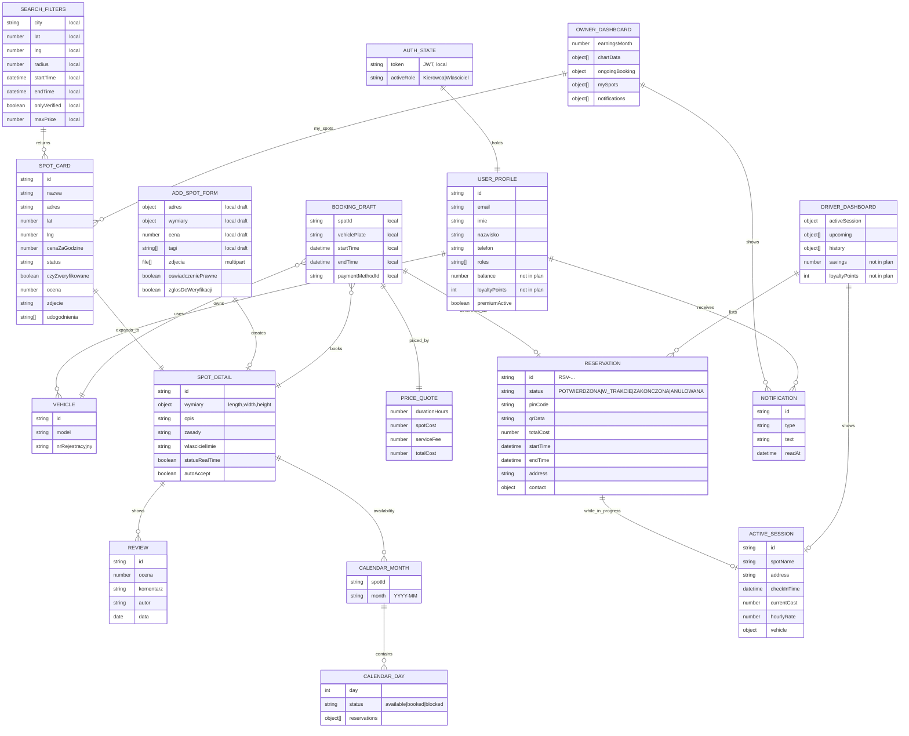

# Frontend ERD (client-side view models)

Data shapes used by the React frontend screens (API DTOs plus local UI state). Field names follow the frontend contract; the mapping to database columns is in Confluence: *PARI data model (ERD): backend and frontend*.

