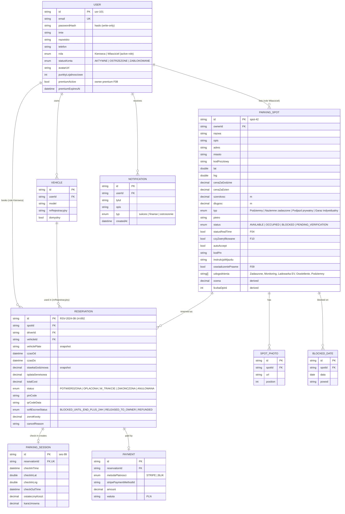

# ERD derived from the frontend OpenAPI contract

Source: `dizincorp/PARI_Eng_Project_front` -> `docs/api/openapi.yaml` (components/schemas).
Field names are the frontend's (Polish) names, mapped to English entity names.

## Diagram

## Mapping: OpenAPI schema -> entity

| OpenAPI schema | Entity / note |
| --- | --- |
| `UserProfile`, `RegisterRequest`, `SwitchRole*` | `USER` |
| `Vehicle`, `AddVehicleRequest` | `VEHICLE` |
| `ParkingSpot`, `CreateSpotRequest`, `Coordinates`, `OwnerContact` | `PARKING_SPOT` (+ `SPOT_PHOTO`); `OwnerContact` is a projection of `USER` |
| `ToggleRealtimeStatus*`, `OwnerSpaceItem` | views of `PARKING_SPOT.statusRealTime/status` |
| `SpotCalendarResponse`, `BlockDate*` | `BLOCKED_DATE` + computed day status from `RESERVATION` |
| `CalculateReservation*` | no entity, computed (`stawka * hours + oplataSerwisowa`) |
| `CreateReservationRequest`, `ReservationConfirmedResponse`, `CancelReservationResponse` | `RESERVATION` (+ `PAYMENT`) |
| `ActiveSession`, `CheckOutResponse` | `PARKING_SESSION` |
| `DriverDashboardResponse`, `UpcomingReservationItem`, `HistoryItem` | views over `RESERVATION` / `PARKING_SESSION` |
| `OwnerDashboardResponse`, `OwnerNotificationItem` | views over `PARKING_SPOT` / `RESERVATION`; `NOTIFICATION` |
| `ErrorResponse`, `AuthResponse` | transport only |

## Gaps and inconsistencies in the contract

- Reservation status enum is `OPLACONA` in `ReservationConfirmedResponse` but `OPŁACONA` (with diacritic) in `UpcomingReservationItem`.
- `ParkingSpot.udogodnienia` enum has `Ładowarka EV`, while `CreateSpotRequest` examples use `EV Charging`.
- `ParkingSpot.status` is English machine values while `OwnerSpaceItem.status` and `ToggleRealtimeStatusResponse.status` are free Polish strings.
- Reviews are implied by `ocena`/`liczbaOpinii` but no review schema exists, so `REVIEW` is missing.
- Premium (F08) is only in the endpoint list, with no schema. `premiumActive` and `premiumExpiresAt` on `USER` are inferred.
- `kodPin` is exposed on `ParkingSpot` for all readers. It should only be returned for confirmed reservations.
- IDs are free-form strings (`usr-101`, `spot-42`, `RSV-...`). The backend should decide between UUIDs and a display code.
