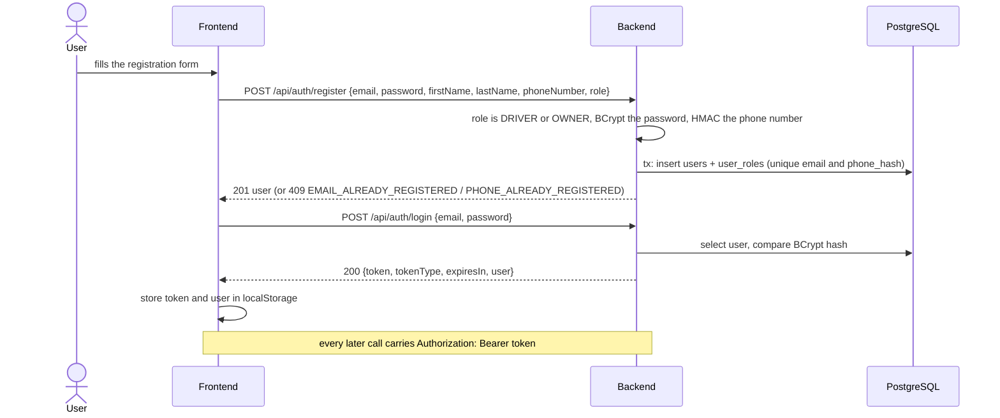
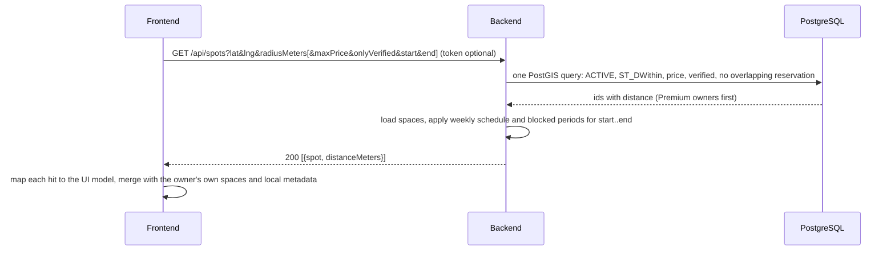
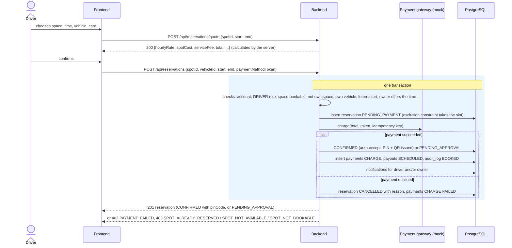
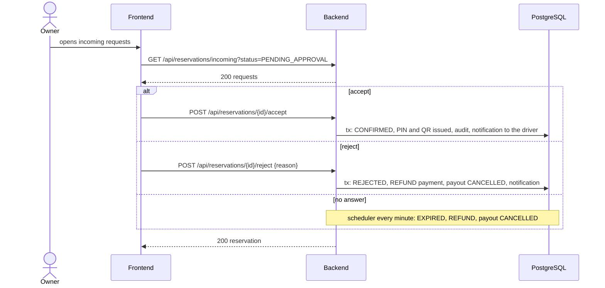
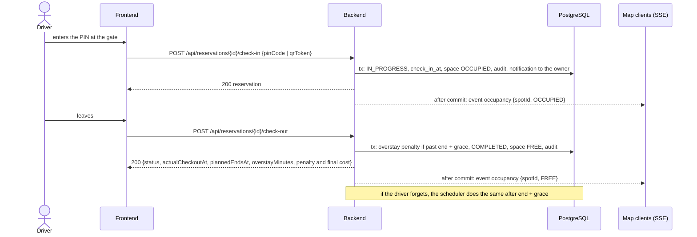
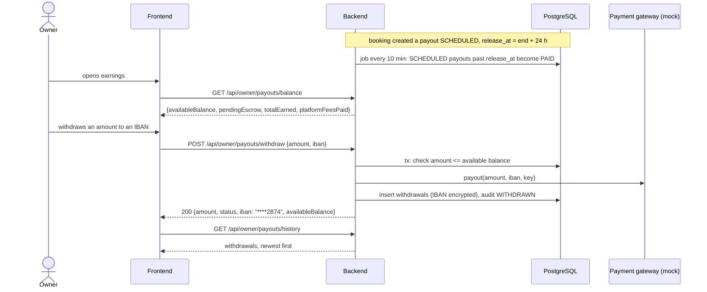

# Frontend and backend interaction

How the React web application (`PARI_Eng_Project_front`) talks to the backend: the transport, the API client, what each user action sends and receives, and the transactions behind it. It describes the code on `main` of both repositories. Endpoint details are in [api-reference.md](api-reference.md), the backend side of each rule in [backend-concepts.md](backend-concepts.md), the stored data in [data-layer.md](data-layer.md). Section 7 lists where the two sides do not match yet.

## 1. Transport

| Environment | Browser talks to | `/api` and `/media` go to |
| --- | --- | --- |
| Development (`npm run dev`) | Vite dev server `http://localhost:3000` | proxied to `http://localhost:8080` (`vite.config.js`) |
| Docker (`docker compose up -d`) | nginx in the `front` container, port 3000 | nginx proxies `/api/` to `http://backend:8080` (`nginx.conf`) |

The client always uses the relative base `/api` (or `VITE_API_URL`), so the browser sees one origin and no CORS configuration is needed. Data is JSON over HTTP; images are `multipart/form-data`; live occupancy is Server-Sent Events. There is no WebSocket.

## 2. The API client

All calls go through `src/services/api.js` (about 2000 lines, object `apiService`). It is the only place that knows endpoints and DTO shapes.

| Aspect | Behaviour |
| --- | --- |
| Request helper | `apiFetch(endpoint, options, timeoutMs = 4000)`: `fetch` with an abort timeout of 4 s (2 s for the health probe). |
| Headers | `getHeaders()` sends `Content-Type`, `Accept`, `Authorization: Bearer <token>` and `X-User-Id`. The backend ignores `X-User-Id` unless the development switch is on. |
| Token | After login the JWT is kept in `localStorage` (`parkshare_auth_token`) together with the user (`parkshare_user`) and the active role (`parkshare_role`). Logout removes them and the cached data. |
| Demo fallback | With no stored token, `getAuthToken(role)` logs in with the demo accounts (`jan.driver@pari.test`, `anna.owner@pari.test`, password `Demo1234!`). These exist only in the **seeded** database; on a clean database that login fails and calls are anonymous. |
| Errors | `parseErrorResponse` reads the common error body (`errorCode`, `message`), translates known messages to Polish and throws an `Error` with `status`, `errorCode` and `details`. |
| Language | The UI model is Polish (`nazwa`, `cenaZaGodzine`, `kierowca`), the DTOs are English. `mapBackendSpotToFrontend`, `mapBackendReservationToFrontend` and the `map...ToBackend` functions translate in both directions. |
| Money and time | The backend sends decimal PLN amounts and ISO-8601 UTC instants; the client formats them with `formatIsoToLocalTime` and `formatIsoToLocalDate`. Prices are never sent by the client. |
| Local cache | The client also keeps copies in `localStorage` (`parkshare_all_reservations`, `parkshare_custom_spots`, `parkshare_spot_meta_<id>`, `parkshare_owner_data`, `parkshare_phone_<id>`, ...) and falls back to built-in mock data (`src/data/mockData.js`) when the backend does not answer. See section 7. |

## 3. Screens and the calls they make

| Screen (view) | Action | Client function | Request |
| --- | --- | --- | --- |
| Auth | register | `register` | `POST /api/auth/register` |
| Auth | log in | `login`, then `getMe` | `POST /api/auth/login`, `GET /api/auth/me` |
| Settings | edit profile, avatar | `updateProfile`, `uploadAvatar` | `PUT /api/auth/profile`, `POST /api/users/me/avatar` |
| Settings | change password | not wired yet | `POST /api/auth/change-password` |
| Search | find spaces on the map | `getSpots` | `GET /api/spots?lat&lng&radiusMeters` (radius clamped to 50 000 m) |
| Search / Booking | space details, reviews | `getSpots`, `getSpotReviews` | `GET /api/spots`, `GET /api/spots/{id}/reviews` |
| Booking | price preview | `quoteReservation` | `POST /api/reservations/quote` |
| Booking | book and pay | `createReservation` | `POST /api/reservations` |
| Driver dashboard | my reservations | `getReservations` | `GET /api/reservations` |
| Driver dashboard | running session | `getActiveSession` | `GET /api/reservations/active-session` |
| Reservation details | cancel | `cancelReservation` | `POST /api/reservations/{id}/cancel` |
| Reservation details | enter the gate | `checkIn` | `POST /api/reservations/{id}/check-in` |
| Driver dashboard | leave | `checkOut` | `POST /api/reservations/{id}/check-out` |
| Reservation details | rate the space | `createReview` | `POST /api/reservations/{id}/reviews` |
| Vehicles | list, add, delete | `getVehicles`, `createVehicle`, `deleteVehicle` | `GET`, `POST /api/vehicles`, `DELETE /api/vehicles/{id}` |
| Add space | create the space | `createSpot` (also sends the weekly rules), `uploadMedia` | `POST /api/spots`, `POST /api/media/upload`, `PUT /api/spots/{id}/availability-rules` |
| My spaces | list, edit, switch, remove | `getMySpots`, `updateSpot`, `activateSpot`/`deactivateSpot`, `deleteSpot`, `addSpotPhoto`/`deleteSpotPhoto` | `GET /api/spots/mine`, `PUT`/`DELETE /api/spots/{id}`, `POST /api/spots/{id}/activate`, `/deactivate`, `POST`/`DELETE /api/spots/{id}/photos` |
| Calendar | rules, blocks, booked slots | `getSpotAvailabilityRules`, `blockSpotPeriod`/`deleteBlockedPeriod`, `getBookedSlots` | `GET /api/spots/{id}/availability-rules` (`PUT` is sent when a space is created), `POST`/`DELETE /api/spots/{id}/blocked-periods`, `GET /api/spots/{id}/booked-slots` |
| Owner dashboard | incoming requests | `getIncomingReservations`, `acceptReservation`, `rejectReservation` | `GET /api/reservations/incoming`, `POST /api/reservations/{id}/accept`, `/reject` |
| Owner dashboard | earnings | `getOwnerAnalytics`, `getOwnerBalance`, `withdrawOwnerEarnings` | `GET /api/owner/analytics`, `GET /api/owner/payouts/balance`, `POST /api/owner/payouts/withdraw` |
| Owner dashboard | Premium | `subscribePremium`, `getPremiumStatus` | `POST /api/subscriptions/premium`, `GET /api/subscriptions/my-status` |
| Header | notifications | `getNotifications`, `markNotificationRead` | `GET /api/notifications`, `PATCH /api/notifications/{id}/read` |
| (defined, no view uses it) | live occupancy | `subscribeToSpotEvents` | `GET /api/spots/events` (SSE) |

## 4. Transactions

Each diagram shows one business operation from the click to the committed data. "tx" marks the single database transaction of the backend service call.

### 4.1 Register and log in

### 4.2 Find a space

### 4.3 Book and pay

If two drivers send the same slot at once, both pass the application check; the database lets one insert succeed and rejects the other, which receives `409 SPOT_ALREADY_RESERVED`.

### 4.4 The owner decides (spaces without auto-accept)

### 4.5 The parking session

### 4.6 Money to the owner

### 4.7 Images

`POST /api/spots/{id}/photos` (or `POST /api/media/upload` before the space exists) takes `multipart/form-data`. The backend checks that the caller may manage the space, validates the type from the file bytes and the 5 MB limit, stores the file under a random name in the media volume, inserts `spot_photos` and answers with the public URL `<PARI_PUBLIC_BASE_URL>/media/<key>`. If the database update fails the file is removed again. The browser then loads the image directly from `/media/...` (public, served by the backend). Avatars work the same way through `POST /api/users/me/avatar`, which also replaces the previous file.

### 4.8 Notifications

Reservation events create rows in `notifications` inside the same transaction (section 5 of [backend-concepts.md](backend-concepts.md)). The client reads them with `GET /api/notifications` when the application loads and merges them into the bell menu; `PATCH /api/notifications/{id}/read` marks one as read. There is no push: a new notification appears after the next load.

## 5. Status vocabulary

| Backend `status` | What the UI shows | Notes |
| --- | --- | --- |
| `PENDING_APPROVAL` | waiting for the owner | driver can cancel; owner sees it in incoming requests |
| `CONFIRMED` | confirmed, PIN and QR available | `reservationStatus.js` also uses the clock to decide "upcoming" or "past" |
| `IN_PROGRESS` | running session, timer | |
| `COMPLETED` | finished | can be reviewed once |
| `CANCELLED`, `REJECTED`, `EXPIRED` | cancelled, rejected, expired | refunded in full (except a declined payment, where nothing was charged) |

Space amenities are exchanged as codes (`CCTV`, `LIGHTING`, `EV_CHARGER`, `COVERED`, `GATE`, `WIDE_SPACE`) and translated by the `AMENITY_TO_BACKEND` and `AMENITY_TO_FRONTEND` tables in the client.

## 6. Who owns which data

| Data | Source of truth | Client copy |
| --- | --- | --- |
| Accounts, roles, vehicles, spaces, availability, reservations, payments, payouts, reviews, notifications | backend database | cached in memory; some also in `localStorage` |
| Prices, fees, commission, penalties, discounts | backend (`platform_settings`) | none; the client only displays what the server calculated |
| PIN and QR token of a reservation | backend, returned to the driver | shown on the ticket |
| Space attributes the backend has no field for (type, floor, daily and monthly price, custom photo URL) | **client** (`parkshare_spot_meta_<id>`) | `localStorage` |
| Session timers, "last finished session", UI view | client | `localStorage` |

## 7. Where the client and the server do not match yet

These are facts about the current code, recorded so they can be fixed deliberately.

1. **A failed booking can look successful.** `createReservation` first stores a local `CONFIRMED` reservation with a random PIN, then calls `POST /api/reservations`. When the backend answers an error (`402` declined card, `409` slot taken) or does not answer, the function returns the **local** reservation, so the driver sees a confirmed booking that does not exist on the server. The same fallback style exists for check-out, cancel and spot changes.
2. **Live occupancy never reaches the UI.** The backend sends the named event `occupancy`; the client's `subscribeToSpotEvents` uses `EventSource.onmessage`, which only receives unnamed events, and no view calls it anyway.
3. **Price preview can be invented.** If `POST /api/reservations/quote` fails, the client computes a price itself with a flat fee of 2.50 PLN, while the server's service fee is a percentage of the spot cost (5 % placeholder). The server's price is the one charged.
4. **Rental types are not wired.** The booking request has no `bookingType` or `durationMonths`, so the UI's daily and monthly options are priced and sent as hourly bookings; the server supports `DAILY` and `MONTHLY` with discounts.
5. **Demo auto-login** needs the seeded database; the clean database has no demo accounts.
6. **Defaults for missing data**: when a field is absent the client fills stock text, a stock photo and, for the PIN of a space, `4921`; `czyZweryfikowane` defaults to `true` when the backend sends no verified flag.
7. **Change password** exists on the server (`POST /api/auth/change-password`) but the settings screen does not call it.
8. **Token lifetime**: tokens last 24 h and there is no refresh; an expired token makes calls fail with `401` until the user logs in again.
9. **Cache keys by user**: some `localStorage` keys are per user and some are global (`parkshare_all_reservations`), so two accounts in one browser can see each other's cached items until logout clears them.
